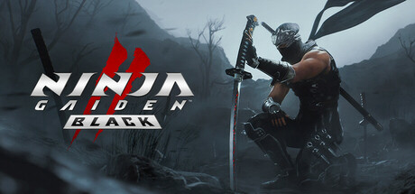

**Ninja Gaiden 2 Black by Team Ninja (2025) is the remaster of Ninja Gaiden II Sigma, featuring updated visuals and refined mechanics.**

---

## 📖 About

Ninja Gaiden 2 Black by Team Ninja (2025) is the remaster of Ninja Gaiden II Sigma, featuring updated visuals and refined mechanics. The original NG2 is considered by many the hardest action game ever made — 2 Black preserves that reputation while improving performance and adding content.

## ⚠️ Problems Without Trainer

| Problem | Status |
|---------|--------|
| Obliteration technique spam from severed enemies overwhelms without OT priority | ✅ Solved |
| Essence absorb required for upgrades demands risky close-range play under fire | ✅ Solved |
| Archfiend fights combine multiple enemy types simultaneously in tiny arenas | ✅ Solved |
| Karma rank gates force grinding specific chapters before progression unlocks | ✅ Solved |
| Electric arrows and projectile spam from ranged enemies prevent melee engagement | ✅ Solved |

## ✅ Solution

The **Ninja Gaiden 2 Black Trainer** solves all these issues, giving you complete control so you can focus on enjoying the game.

## 🎯 Features

- Unlimited Resources / Currency
- God Mode / Invincibility
- Instant Skill & Ability Cooldown
- One-Hit Kill
- Freeze Timers
- Unlock All Items & Achievements
- Custom Speed Multiplier
- Infinite Stamina / Energy

## 🚀 Quick Start

1. **Disable Windows Defender** temporarily (trainer may trigger false positive)
2. Get the trainer from the button above
3. Launch Ninja Gaiden 2 Black
4. Run the trainer as Administrator
5. Use the hotkeys to activate cheats in-game

## 💎 Free vs Pro

| Feature | Free | Pro |
|---------|------|-----|
| God Mode | ✅ | ✅ |
| Unlimited Resources | ✅ | ✅ |
| Advanced Cheats | ❌ | ✅ |
| Auto-Updates | ❌ | ✅ |
| Priority Support | ❌ | ✅ |

## 💻 Requirements

- Windows 10 / 11 (64-bit)
- Ninja Gaiden 2 Black (any version)
- .NET Framework 4.8+
- DirectX 11+

## 🍎 macOS

## ⚖️ Legal

Educational and single-player use only.

---

